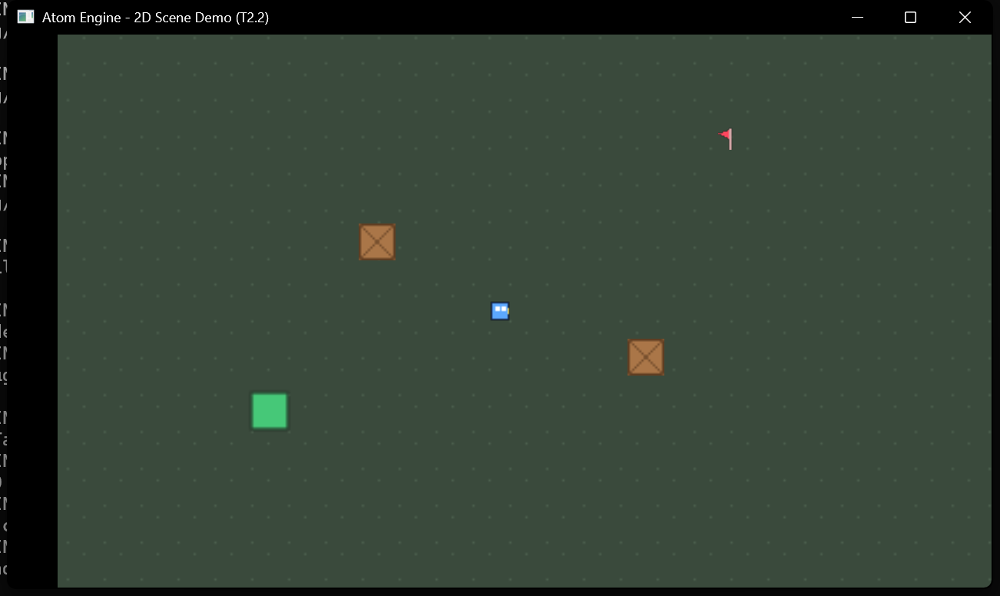

# Example/Game — 2D scene demo (T2.2)

引擎里第一个**世界来自场景文件**的示例：`Example/Game/Assets/scenes/smoke_room.scene.json` 定义房间内容，C++ 只负责
系统、渲染和一段装饰用的地板。

## 运行

```powershell
cmake --build cmake-build-debug --target Example_2D_Smoke
.\cmake-build-debug\Example_2D_Smoke.exe
```

- WASD / 方向键：移动（两个都绑定到同一个 action）
- E：切换相机 1x / 2x（一次性 action，演示 "按下这一帧" 与"按住"的区别）
- Space / Esc：暂停世界（画面继续渲染，所以"暂停"是可见的；暂停期间移动与 E 都无效）
- 关闭窗口：退出



截图里的东西全部来自场景文件：两块木箱、玩家、图集子矩形（绿块），以及被 `flip_x` 镜像的粉色小旗
（`pivot` 设为底部居中，所以它插在地上）。

## 数据来自哪里

| 内容 | 来源 |
|---|---|
| 相机、玩家、图集格、过期标记 | `Assets/scenes/smoke_room.scene.json`（本示例自己的内容根） |
| 两个木箱 | `Assets/prefabs/crate.prefab.json` 的**两个实例**，只覆盖位置/排序键/名字 |
| 绿格子 | `Assets/atlases/terrain.atlas.json` 的 `green` 帧（含 `filter: nearest`） |
| 地板 | C++ 生成（`AddBackdrop`）：**装饰**，T5.1 的 Tilemap 会用地砖集生成这一层 |
| 移动与跟随相机 | C++ 系统（`RegisterSmokeSystems`） |

改关卡不需要重编译：编辑 JSON，重开程序即可。格式见 `Docs/Plans/Scene-Schema-v1-CN.md`。

## 它验证了什么

| 环节 | 落点 |
|---|---|
| JSONC 解析、行号列号报错 | `Utilities/Json`（`Atom_Json.Reader`） |
| 字段/取值/相机唯一性校验、错误一次收集 | `Scene/SceneSchema`（`Atom_Scene.SceneLoader`） |
| 加载到**临时**世界，成功后一次替换 | `Scene/SceneLoader` + `GameWorld::ReplaceEntities` |
| 替换后系统仍在跑、帧计数不重置 | `Atom_Runtime.WorldReplace` |
| 系统按 `SceneEntityId` 查实体，而不是缓存句柄 | `FindBySceneId` |

## 两个必须知道的坑

1. **不要缓存 `Entity`**。换世界后索引会重用，旧句柄可能"碰巧还活着"——新世界的第一个实体与旧世界的第一个
   实体有相同的 index/generation。要么每帧按 `SceneEntityId` 查，要么把
   `GameWorld::GetWorldGeneration()` 一起缓存、变了就重查。
2. **Prefab 只描述"它是什么"**。实例能改位置、颜色、层级、朝向、寿命，但改不了贴图/图集矩形/尺寸/轴心；
   想改这些就改 prefab 本身，或复制一个新的 prefab。
2. **地板是代码加的**。它在换世界之后创建，否则会被整体替换掉。T5.1 之后这一层交给 Tilemap。

## 刻意不做

- 没有物理与碰撞（T3.1），移动是直接写 `Transform2D`；
- 没有 HUD 与重开流程（T3.3）；
- 没有图集元数据（下一步 `Sprite/`）与 Tilemap（T5.1）；
- 不写 `Atom.cpp`：示例是独立可执行文件，引擎入口保持干净。
